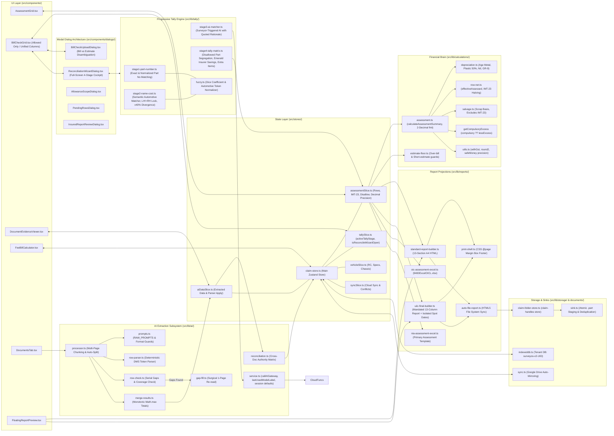
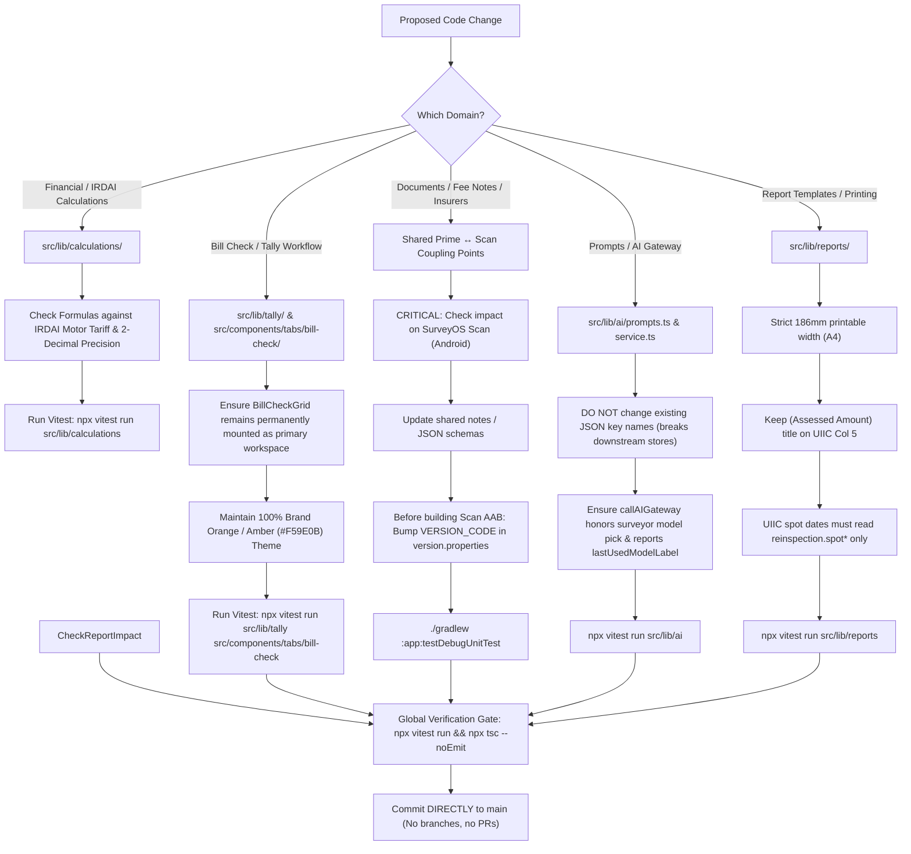

# Complete Codebase Architecture & Change Impact Map

> Authoritative reference for architecture, module interconnections, data lifecycles, and coupling rules across SurveyOS Prime V2, SurveyOS Scan, and the Chrome Extension.
> Last updated: 2026-11-17 (Incorporating Bill Check Progressive Tallying Cockpit, Modal Dialog Architecture, UIIC Spot Date Consolidation, Universal AI Model Selection, and 2-Decimal Rupee Financial Precision).

---

## 1. High-Level Ecosystem Topology

The SurveyOS ecosystem consists of three coordinated runtimes sharing synchronized schemas, calculation logic, and storage backends:

```mermaid
graph TD
    subgraph MobileField["Mobile Field Client (SurveyOS Scan)"]
        ScanApp["Android Native (Kotlin / Jetpack Compose)"]
        RoomDB["Room SQLite (Drafts, Shared Sync Map)"]
        DriveExport["Google Drive Backup & ZIP Packets"]
        ScanApp --> RoomDB
        ScanApp --> DriveExport
    end

    subgraph DesktopCore["SurveyOS Prime V2 (Web / PWA)"]
        NextCore["Next.js 16 App Router (React 19 / TS 5)"]
        ZustandStores["Zustand Modular Slices (claim-store, tallySlice, aiDataSlice, uiSlice)"]
        CalcEngine["IRDAI Calculation Engine (Depreciation, GST, IMT-23, Excess, 2-Decimal Precision)"]
        AIEngine["AI Extraction & Deterministic DMS Parsers (row-parser, gap-fill, Universal Gateway)"]
        TallyEngine["Progressive Tally Engine (Stage 1 Part No, Stage 2 Semantic, Stage 3 AI, Stage 4 Disallowed)"]
        ModalWizards["Accessible Modal Dialog Architecture (UploadDialog, ReconciliationWizard)"]
        ReportEngine["Report Projection (Standard A4, UIIC 5-Page, OIC/NIA Excel)"]
        IDB["IndexedDB Tenant Storage (surveyos-v2-UID)"]
        FSHandles["File System Access API (claim-handles store)"]
        
        NextCore --> ZustandStores
        ZustandStores <--> CalcEngine
        ZustandStores <--> AIEngine
        ZustandStores <--> TallyEngine
        NextCore --> ModalWizards
        ModalWizards <--> TallyEngine
        ZustandStores --> ReportEngine
        ZustandStores <--> IDB
        ReportEngine --> FSHandles
    end

    subgraph ExtensionSidecar["Chrome Extension (MV3 Sidecar)"]
        ExtPanel["Isolated World (panel.js, observer.js)"]
        ExtMain["Main World (filler.js, react-write.js, semantic-ai.js)"]
        LearnedStore["Learned Mappings Store (learned-store.js)"]
        
        ExtPanel <-->|window.postMessage| ExtMain
        ExtMain --> LearnedStore
    end

    subgraph CloudInfra["Cloud Infrastructure (Firebase & AI)"]
        FirebaseAuth["Firebase Auth (Google OAuth & Silent Sandbox Anonymous)"]
        Firestore["Firestore DB (asia-south1: Claims, RBAC, Consensus)"]
        CloudFuncs["Cloud Functions (callAI, bramha.js, subscription.js, BYOK proxy)"]
        GDriveAPI["Google Drive REST API (Photos, Backups)"]
        LLMProviders["AI Providers (Gemini 2.5 / Groq Llama / NVIDIA NIM / Ollama)"]
    end

    subgraph InsurerPortals["PSU Insurer Web Portals"]
        UIICPortal["UIIC Web Portal (AngularJS / ASP.NET)"]
        OICPortal["Oriental Insurance Core Portal (PrimeReact / React)"]
        NIAPortal["New India Assurance Portal (JSP / Forms)"]
        NICPortal["National Insurance Portal"]
    end

    %% Inter-system communication
    DriveExport -->|ZIP / Backup JSON| NextCore
    NextCore <-->|Sync Queue| Firestore
    NextCore <-->|OAuth Tokens / File Sync| GDriveAPI
    NextCore <-->|Auth Session| FirebaseAuth
    AIEngine -->|Universal AI Gateway / Session Fallback| CloudFuncs
    CloudFuncs --> LLMProviders
    NextCore -->|Portal Packet / JSON| ExtPanel
    LearnedStore -.->|Zero-PII Consensus| Firestore
    ExtMain -->|DOM Keystroke / Native Setters| UIICPortal
    ExtMain -->|Fiber Props Injection| OICPortal
    ExtMain -->|DOM Automation| NIAPortal
    ExtMain -->|DOM Automation| NICPortal
```

---

## 2. Core Subsystems & Module Interconnections

---

## 3. End-to-End Claim Lifecycle & Data Transformation Flow

```mermaid
flowchart TD
    Start([Claim Intake]) --> IntakeType{Intake Source}

    %% Intake Branches
    IntakeType -->|Mobile Field Survey| ScanImport["Scan Import: _surveyos-scan.json / Drive ZIP"]
    IntakeType -->|Desktop Intake| ManualCreate["Manual Creation / Policy PDF Upload"]

    ScanImport --> NotesPlanner["notes.ts (NOTES_ALLOW_LIST: Fill vs Differ)"]
    NotesPlanner --> ClaimStoreLoad["Populate ClaimStore (date, time, place, spotDetails)"]
    ManualCreate --> ClaimStoreLoad

    %% Document Ingestion
    ClaimStoreLoad --> UploadDocs["Surveyor Uploads Documents (RC, DL, Policy, Estimate, etc.)"]
    UploadDocs --> DocGate{Is Tabular Bill / Estimate?}

    DocGate -->|Yes| CheckDigital{PDF Born Digital?}
    CheckDigital -->|Yes: VW, Skoda, Maruti, Tata, BharatBenz| DMSParse["Deterministic Parser: row-parser.ts (0 Tokens)"]
    DMSParse --> ValidateSum{Row Sum == Printed Gross?}
    ValidateSum -->|Yes| MergeDMS["Extract Metadata Header & Form Rows"]
    ValidateSum -->|No| VisionChunk

    CheckDigital -->|No: Scanned / Custom| VisionChunk["Chunk Processor: processor.ts (2-page chunks)"]
    DocGate -->|No: RC, DL, Policy, FIR| VisionChunk

    VisionChunk --> JSONCheck{Parse Success?}
    JSONCheck -->|Parse Error / Truncation| AutoSplit["Auto-Split Chunk into 1-Page Calls"]
    AutoSplit --> Accumulate["mergeAIResults (Math.max for Totals)"]
    JSONCheck -->|Success| Accumulate

    Accumulate --> GapGate{Tabular Estimate?}
    GapGate -->|Yes| SerialCheck["row-check.ts (Coverage >= 80% & Gap Detection)"]
    SerialCheck -->|Gaps <= 6 Pages| SurgicalReRead["gap-fill.ts (Targeted Vision Re-read)"]
    SurgicalReRead --> ReconcileHub
    SerialCheck -->|No Gaps| ReconcileHub
    GapGate -->|No| ReconcileHub

    ReconcileHub["Reconciliation Hub: reconciliation.ts (Priority: FIR > RC > Policy > DL)"]
    ReconcileHub --> ReviewDialog["Surveyor Review & Apply Dialog"]
    ReviewDialog --> ActiveClaim["Active Claim State (Zustand)"]

    %% Assessment & Financial Brain
    ActiveClaim --> AssessmentScreen["Tab 4: Damage Assessment Grid (DecimalInput, Excel Keys, Shared Selection)"]
    AssessmentScreen --> FinancialBrain["Financial Engine: assessment.ts (2-Decimal Rupee Precision)"]
    
    subgraph CalcRules["IRDAI Rules Applied Automatically"]
        DepRule["Depreciation: Metal 0-50% by loss age, Plastic 50%, Glass 0%"]
        IMT23Rule["IMT-23: Halve Assessed Basis before Depreciation"]
        GR9Rule["Painting: 50% dep on 25% paint material = 12.5% effective"]
        SalvageRule["Salvage Scrap Basis: Metal parts only, ignores IMT-23"]
        DisposalRule["Disposal Parts: 0% GST, net * disposalPercent"]
        PrecisionRule["Rupee Precision: withGst, 2-decimal rounding, zero drift"]
    end
    FinancialBrain --- CalcRules

    %% Post-Repair Bill Check
    FinancialBrain --> RepairPhase{Repairs Complete?}
    RepairPhase -->|No| GenFinalSurvey["Generate Final Survey Report"]
    RepairPhase -->|Yes| BillCheckTab["Tab 5: Bill Check Workspace (BillCheckGrid)"]

    BillCheckTab --> UploadDialog["BillCheckUploadDialog.tsx (Upload Document Button)"]
    UploadDialog --> DocTypeChoice{Document Type?}
    DocTypeChoice -->|Final Workshop Bill| Case1["Case 1: Claim Built from Estimate (Reconcile Bill)"]
    DocTypeChoice -->|Repair Estimate| Case2["Case 2: Claim Built from Bill (Reconcile Estimate)"]

    Case1 --> WizardLaunch["ReconciliationWizardDialog.tsx (Brand Orange 4-Stage Cockpit)"]
    Case2 --> WizardLaunch

    subgraph FourStageCockpit["4-Stage Reconciliation Cockpit"]
        Stage1Flow["Stage 1: Part Numbers (Exact & Normalized Part No, Price Delta)"]
        Stage2Flow["Stage 2: Name & Cost (Semantic Automotive Normalization, LH!=RH Lock, ±40% Divergence)"]
        Stage3Flow["Stage 3: Surveyor-Triggered AI (Side-by-side assessment rows vs uploaded lines, Quoted Reasons)"]
        Stage4Flow["Stage 4: Disallowed & Insurer Savings (Isolate ₹0 Liability parts, Emerald Savings, Extra Items Tray)"]
        Stage1Flow --> Stage2Flow --> Stage3Flow --> Stage4Flow
    end
    WizardLaunch --> FourStageCockpit

    FourStageCockpit --> ApplyReconciliation["[Apply to Assessment Grid & Finish]"]
    ApplyReconciliation --> PristineGrid["BillCheckGrid.tsx (Allowed Only Filter, Pinned Columns, Unified Headers)"]
    PristineGrid --> GenBillCheckReport["Generate Bill Check Report"]

    %% Report Generation & Outputs
    GenFinalSurvey --> ReportOutputs["Report Dispatcher"]
    GenBillCheckReport --> ReportOutputs

    subgraph Projections["Multi-Format Exporters"]
        StdHTML["Standard Report Builder (13 Sections, 186mm A4 Print Shell)"]
        UIICHTML["UIIC Builder (13 Columns, Assessed Col 5, Isolated Spot Dates)"]
        OICWorkbook["OIC Excel (9400ExcelOICL.xlsx with 12.5% Painting Split)"]
        NIAWorkbook["NIA Excel (Primary Assessment Template with Nil-Dep Bypass)"]
        FeeInvoice["Spot Fee Bill (SAC 998549 18% GST, Distance & Photos)"]
    end
    ReportOutputs --> Projections

    %% Sinks and Downstream Sync
    Projections --> AutoFileSink["auto-file-report.ts (HTML5 File System Access API)"]
    AutoFileSink --> LocalDisk[("Surveyor Local Disk (Isolated Claim Directory)")]
    
    Projections --> SyncQueue["Sync Queue: useCloudSync"]
    SyncQueue --> CloudFirestore[("Cloud Firestore (asia-south1)")]
    SyncQueue --> GoogleDriveBackup[("Google Drive Backup Vault")]

    %% Portal Auto-Fill
    Projections --> PortalExport["Export Portal Packet"]
    PortalExport --> Extension["Chrome MV3 Extension"]
    Extension --> InjectDOM["Inject Core Insurer Portals (UIIC / OIC / NIA / NIC)"]
    InjectDOM --> Done([Claim Dispatched & Settled])
```

---

## 4. Directory & Codebase Layout Reference Map

| Directory | Files | Lines | Key Modules & Patterns |
|---|---|---|---|
| [`src/lib/tally/`](file:///c:/Users/Manasi/OneDrive/Desktop/Antigravity%20Surveyor%20V6%20fixed/SurveyOS-Prime-V2/src/lib/tally) | 6 | 1,450 | `stage1-part-number.ts` (exact/normalized part number matching, price delta), `stage2-name-cost.ts` (automotive semantic match, directional locks, ±40% divergence guard), `stage3-ai-matcher.ts` (surveyor-triggered AI matching with quoted rationales), `stage4-tally-matrix.ts` (disallowed parts isolation with ₹0 liability, insurer savings tally, extra items promoter), `fuzzy.ts`. |
| [`src/components/dialogs/`](file:///c:/Users/Manasi/OneDrive/Desktop/Antigravity%20Surveyor%20V6%20fixed/SurveyOS-Prime-V2/src/components/dialogs) | 8 | 2,150 | `BillCheckUploadDialog.tsx` (accessible document disambiguation between Final Bill and Estimate, drag & drop), `ReconciliationWizardDialog.tsx` (full-screen 4-stage reconciliation wizard), `AllowanceScopeDialog.tsx`, `PendingRowsDialog.tsx`, `InsuredReportReviewDialog.tsx`. |
| [`src/components/tabs/bill-check/`](file:///c:/Users/Manasi/OneDrive/Desktop/Antigravity%20Surveyor%20V6%20fixed/SurveyOS-Prime-V2/src/components/tabs/bill-check) | 11 | 3,280 | `BillCheckGrid.tsx` (pristine spreadsheet workspace, "Allowed only" toggle, unified column order in both cases), `BillCheckHeader.tsx` (Brand Orange `[Upload Document]` button, `[Reconciliation Cockpit (N)]` pill, restored `[Final bill]` / `[Estimate]` switch), `BillCheckStepper.tsx`, `StageReviewTable.tsx`, `StageAITrigger.tsx`, `StageAuditView.tsx`, `BillCheckFlagRow.tsx`, `config.ts`. |
| [`src/lib/calculations/`](file:///c:/Users/Manasi/OneDrive/Desktop/Antigravity%20Surveyor%20V6%20fixed/SurveyOS-Prime-V2/src/lib/calculations) | 16 | 2,180 | `assessment.ts` (summary engine, 2-decimal rupee precision), `depreciation.ts` (age scale, GR-9), `row-net.ts` (IMT-23 halving, disposal), `row-dep-rate.ts` (overrides), `salvage.ts`, `fees.ts`, `estimate-floor.ts`, `utils.ts` (`withGst`, `round2`). |
| [`src/lib/ai/`](file:///c:/Users/Manasi/OneDrive/Desktop/Antigravity%20Surveyor%20V6%20fixed/SurveyOS-Prime-V2/src/lib/ai) | 19 | 3,920 | `service.ts` (`callAIGateway`, `lastUsedModelLabel`, universal session defaults), `prompts.ts` (RAW_PROMPTS, format instructions), `processor.ts` (chunking, 413 fallback, auto-split), `row-parser.ts` (deterministic DMS token parser), `row-check.ts` (gaps), `gap-fill.ts`, `reconciliation.ts`. |
| [`src/lib/reports/`](file:///c:/Users/Manasi/OneDrive/Desktop/Antigravity%20Surveyor%20V6%20fixed/SurveyOS-Prime-V2/src/lib/reports) | 18 | 4,310 | `standard-report-builder.ts` (13 sections A4), `uiic-final-builder.ts` (13 columns, isolated spot dates from `reinspection.spotAppointmentDate/spotSurveyDate/spotReportDate`), `oic-assessment-excel.ts` (12.5% split), `nia-assessment-excel.ts`, `bill-check-mode.ts`, `print-shell.ts`, `auto-file-report.ts`. |
| [`src/lib/storage/`](file:///c:/Users/Manasi/OneDrive/Desktop/Antigravity%20Surveyor%20V6%20fixed/SurveyOS-Prime-V2/src/lib/storage) | 7 | 1,420 | `indexeddb.ts` (tenant-isolated DB `surveyos-v2-UID`), `claim-folder-store.ts` (`claim-handles` IndexedDB v2), `claim-local-store.ts`. |
| [`src/lib/documents/`](file:///c:/Users/Manasi/OneDrive/Desktop/Antigravity%20Surveyor%20V6%20fixed/SurveyOS-Prime-V2/src/lib/documents) | 8 | 1,650 | `sink.ts` (atomic `.part` staging, byte-size deduplication), `folder.ts` (directory management), `print-followup.ts`. |
| [`src/stores/`](file:///c:/Users/Manasi/OneDrive/Desktop/Antigravity%20Surveyor%20V6%20fixed/SurveyOS-Prime-V2/src/stores) | 27 | 5,180 | `claim-store.ts` (root Zustand store), `slices/tallySlice.ts` (`activeTallyStage`, `isReconcileWizardOpen`), `slices/aiDataSlice.ts`, `slices/assessmentSlice.ts`, `slices/vehicleSlice.ts`, `slices/policySlice.ts`, `slices/syncSlice.ts`. |
| [`src/components/`](file:///c:/Users/Manasi/OneDrive/Desktop/Antigravity%20Surveyor%20V6%20fixed/SurveyOS-Prime-V2/src/components) | 258 | 48,900 | Tabbed claim views (`tabs/AssessmentTab.tsx`, `BillCheckTab.tsx`), Evidence viewer (`evidence/`), Modals (`dialogs/`), Layout (`layout/`). |
| [`extension/`](file:///c:/Users/Manasi/OneDrive/Desktop/Antigravity%20Surveyor%20V6%20fixed/SurveyOS-Prime-V2/extension) | 15 | 2,918 | MV3 extension: `isolated/panel.js`, `main/filler.js`, `main/react-write.js` (prototype setter trick), `main/semantic-ai.js`, `main/learned-store.js`. |
| [`functions/`](file:///c:/Users/Manasi/OneDrive/Desktop/Antigravity%20Surveyor%20V6%20fixed/SurveyOS-Prime-V2/functions) | 6 | 613 | Firebase Cloud Functions: `index.js`, `callAI` (multi-key AI gateway), `bramha.js` (DPDP Act compliant RAG vector indexing), `subscription.js`. |

---

## 5. Developer Decision Guide & Change Impact Rules

When making changes to the codebase, follow these mandatory coupling and boundary guardrails:

### Invariant Rules Checklist for Any Change:
1. **Branch Rule:** Work and commit on `main` only. Never create branches or PRs.
2. **Next.js 16 Rules:** Dynamic route `params` and `searchParams` are Promises (`await params`). Do not use deprecated synchronous APIs.
3. **Assessment Is Surveyor-Made:** AI extracts and proposes; it never commits without surveyor review. Validity checks are advice, never hard verdicts.
4. **Isolated Report Styling:** HTML report builders are completely isolated from web app styles (`tailwind.config`). Changes to web UI components must never alter printable HTML reports.
5. **DMS Token Priority:** For born-digital PDFs, deterministic token parsing via `row-parser.ts` is 100% token-free and zero-latency; never force vision calls on digital Maruti/VW PDFs unless text layer is corrupt.
6. **Spreadsheet Grid Invariance:** `BillCheckGrid` must remain the permanent primary view on the Bill Check tab. Multi-step wizards and uploads must live in modal dialogs (`ReconciliationWizardDialog`, `BillCheckUploadDialog`).
7. **Brand Identity:** Strict compliance with **Brand Orange (`#F59E0B`, `amber-500`)** and warm amber accents (`amber-50`, `amber-100`, `amber-300`). Never introduce blue or purple accent gradients into core survey workflows.
8. **Universal AI Model Routing:** All new AI actions must route through `callAIGateway` in `src/lib/ai/service.ts`, honouring the surveyor's active model pick with fallback session creation and `lastUsedModelLabel()` feedback.
