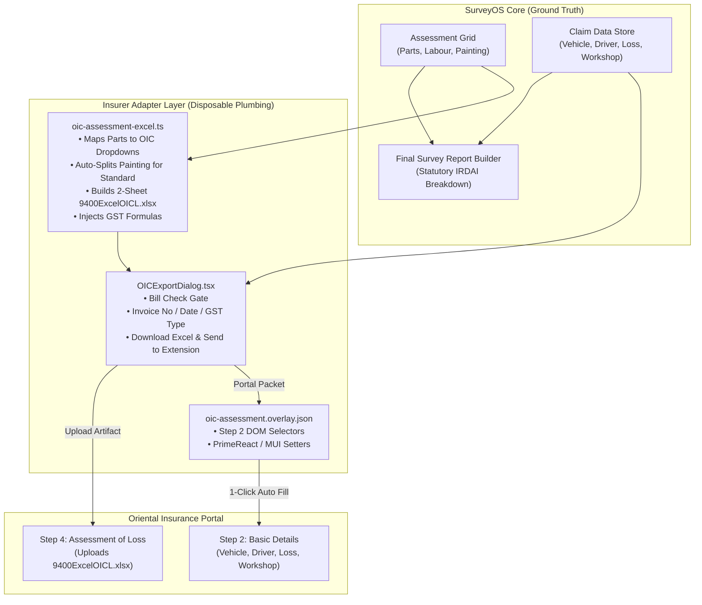

# Design Specification: Oriental Insurance (OIC) Assessment Excel & Portal Mapping

**Spec ID:** `SPEC-2026-11-05-OIC-ASSESSMENT-PORTAL`  
**Status:** Approved / Ready for Implementation  
**Date:** 2026-11-05  
**Author:** Antigravity (applying SPARC methodology & Ruflo architecture patterns)  
**Target:** Motor SurveyOS Prime V2 & SurveyOS Portal Fill Extension  

---

## 1. Problem Statement & Motivation

### The Surveyor's Reality on the OIC Portal
Oriental Insurance Company Ltd (OICL) runs its surveyor claims processing on an internal React + PrimeReact + Material-UI portal (`https://orientalinsurance.org.in/surveyor-assessment-form`). The operational workflow for a surveyor is cumbersome and error-prone:
1. **Disconnected Worklist:** In "My Motor Claims (Surveyor)", claims cannot be opened directly. The surveyor must manually copy the claim number, navigate to "Motor Surveyor OD assessment", manually choose the settlement type (`Cashless` or `Reimbursement`), enter the claim number, and proceed.
2. **Repetitive Form Typing (Step 2 - Basic Details):** Over 25 fields across Vehicle Details, Loss Details, Driver Details, and Workshop Details must be manually re-typed from physical documents despite having already been verified and entered into SurveyOS.
3. **Strict 2-Sheet Excel Format (Step 4 - Assessment of Loss):** The portal requires an uploaded `.xlsx` file (`9400ExcelOICL.xlsx`) with two distinct sheets:
   - Sheet 1: `Invoice` (`Invoice Number`, `Invoice Date`, `Invoice GST Type`, `Invoice Amount`, `Invoice GST Amount`)
   - Sheet 2: `Items` (`Invoice Number`, `Item Description`, `Item Sub Type`, `Side Description`, `Item Amount`, `Depreciation Rate`, `GST Rate`, `Estimated Amount`, `Estimated Amount Remarks`, `HSN Code`, `GST Amount`)
4. **The Painting Calculation Dilemma:**  
   OIC's portal provides no native painting module. It only supports fixed categories (`Labour Charge`, `Metallic Parts`, `Plastic`, `Glass`, `Non-Metalic Parts`, `Others`), each applying a flat depreciation rate across the row.  
   Under Indian Motor Tariff rules on standard policies, painting is 75% labour (0% dep) and 25% material (50% dep), producing an effective 12.5% deduction.  
   To reflect this statutory depreciation on OIC, surveyors are forced to perform manual arithmetic and split painting into two lines.
5. **Report Purity Invariant:**  
   The user explicitly established that **SurveyOS Final Survey Reports must never be altered or compromised for portal workarounds**. IRDAI survey reports are statutory legal documents. The workaround must live strictly in an isolated **Adapter Layer**.

---

## 2. Core Architecture: Clean Adapter Separation

### Architectural Guarantees:
1. **Core Purity:** `src/lib/calculations/` and `src/components/pdf/` have zero dependencies on OIC portal quirks.
2. **Future-Proofing:** When OIC updates their portal (e.g. adding a dedicated painting field or updating DOM IDs), only `oic-assessment-excel.ts` or `oic-assessment.overlay.json` is adjusted. Historical claims and reports require zero data migration.
3. **Safety Fallback:** If OIC modifies an input ID on their page, the extension highlights the unmapped field in the floating panel without throwing errors or blocking the surveyor.

---

## 3. Detailed Component Specifications

### 3.1. OIC Assessment Excel Generator (`src/lib/reports/oic-assessment-excel.ts`)

#### Sheet 1: `Invoice`
- **Columns:**
  - `A`: `Invoice Number` (String / Number, e.g. "INV-01" or estimate number)
  - `B`: `Invoice Date (DD-MM-YYYY)` (String formatted `DD-MM-YYYY` or Excel Date)
  - `C`: `Invoice GST Type` (Validation: `"IGST, CGST/SGST"`)
  - `D`: `Invoice Amount` (Numeric: total assessed items pre-tax amount)
  - `E`: `Invoice GST Amount` (Numeric: total items GST amount)

#### Sheet 2: `Items`
- **Columns:**
  - `A`: `Invoice Number`
  - `B`: `Item Description` (Data Validation: `"Non-Metalic Parts, Metallic Parts, Plastic, Glass, Labour Charge, Others"`)
  - `C`: `Item Sub Type` (Part name / Labour description, cleaned to $\le 100$ characters)
  - `D`: `Side Description` (Data Validation: `"Left, Right, Bottom, Top, Rear, Front, Vertex"` or blank)
  - `E`: `Item Amount` (Numeric: Pre-depreciation assessed amount)
  - `F`: `Depreciation Rate` (Data Validation: `"0, 5, 10, 15, 20, 25, 30, 35, 40, 50"`)
  - `G`: `GST Rate` (Data Validation: `"0, 5, 12, 18, 28"`)
  - `H`: `Estimated Amount` (Numeric: Claimed/estimated amount)
  - `I`: `Estimated Amount Remarks` (String: Optional)
  - `J`: `HSN Code` (Numeric/String: `8512` or tariff HSN)
  - `K`: `GST Amount` (Formula: `=ROUND((E{row}-(E{row}*F{row}/100))*(G{row}/100),2)`)

#### Part & Category Mapping Rules:
- `parts`:
  - `plastic` $\rightarrow$ `Plastic`
  - `metal` $\rightarrow$ `Metallic Parts`
  - `glass` $\rightarrow$ `Glass`
  - `rubber`, `fibre`, other $\rightarrow$ `Non-Metalic Parts`
  - Overridden or miscellaneous $\rightarrow$ `Others`
- `labour`:
  - Category $\rightarrow$ `Labour Charge`
  - Depreciation $\rightarrow$ `0%`
- `paint`:
  - **Nil-Depreciation Policy:**  
    Consolidated single line under `Labour Charge`:  
    `Item Description`: `Labour Charge`  
    `Item Sub Type`: `TOTAL PAINTING CHARGES`  
    `Item Amount`: Full assessed paint amount  
    `Depreciation Rate`: `0`  
    `GST Rate`: `18` (or applicable rate)  
  - **Standard Policy:**  
    Automatic statutory split into two lines:  
    1. Line 1 (Labour 75%):  
       `Item Description`: `Labour Charge`  
       `Item Sub Type`: `PAINTING CHARGES (LABOUR 75%)`  
       `Item Amount`: $\text{Assessed} \times 0.75$  
       `Depreciation Rate`: `0`  
       `GST Rate`: `18`  
    2. Line 2 (Paint Material 25%):  
       `Item Description`: `Plastic` (or `Non-Metalic Parts`)  
       `Item Sub Type`: `PAINT MATERIAL (25% STATUTORY)`  
       `Item Amount`: $\text{Assessed} \times 0.25$  
       `Depreciation Rate`: `50` (or statutory agewise rate)  
       `GST Rate`: `18`  
    - **Paisa-Exact Verification:**  
      $\text{Net} = (0.75 \times A) + (0.25 \times A \times 0.5) = 0.875 \times A$  
      This matches the statutory 12.5% deduction to the exact paisa while producing the exact Rs 500 depreciation line on OIC.

---

### 3.2. OIC Export Dialog (`src/components/dialogs/OICExportDialog.tsx`)
- Accessible via a new **"OIC Excel"** button on `AssessmentGrid.tsx` (styled with indigo branding).
- Mandatory gate: "Bill amounts verified and bill check complete" checkbox.
- Inputs for `Invoice Number`, `Invoice Date`, and `Invoice GST Type` (`CGST/SGST` vs `IGST`), auto-seeded from claim repairer details.
- Live preview showing:
  - Total items count (Parts, Labour, Painting lines)
  - Total Assessed Amount, Total Depreciation, Total GST
  - Painting translation explanation chip (Nil-dep vs Standard split)
- Download button that generates `${claimNo}_OIC_Assessment.xlsx` and auto-files it into the claim's folder via `saveDocuments`.
- Extension bridge button: "Send to Extension" (disabled if extension not installed).

---

### 3.3. Portal Extension Integration (`scripts/portal-map/oic-assessment.overlay.json` & `extension/`)
- Mapped domains: `*://orientalinsurance.org.in/*`.
- **Step 2 (Basic Details) Form Selectors:**
  - `regNumber`: `input#regNumber`
  - `make`: `input#make`
  - `model`: `input#model`
  - `chasisNumber`: `input#chasisNumber`
  - `engineNumber`: `input#engineNumber`
  - `cubicCapacity`: `span#cubicCapacity input` (PrimeReact InputNumber)
  - `manufacturingYear`: `span#manufacturingYear input`
  - `colorOfVehicle`: `input#colorOfVehicle`
  - `typeOfFuel`: `input#typeOfFuel`
  - `driverName`: `input#driverName`
  - `driverDob`: DatePicker `Date of Birth`
  - `driverLicense`: Split inputs `div#driverLicenseNoOne`, `input#driverLicenseNoTwo`, `input#driverLicenseNoThree`
  - `lossDescription`: `textarea#lossDescription`
  - `workshopName`: `input#workshopName`
  - `workshopEstimateAmount`: `span#workshopEstimateAmount input`
- Custom PrimeReact synthetic event dispatches ensuring reactive state updates without losing values on submit.

---

## 4. Verification & Testing Strategy
1. **Unit Tests (`oic-assessment-excel.test.ts`):**
   - Test workbook structure: verifies both `Invoice` and `Items` sheets exist with exact header text.
   - Test data validations: verifies dropdown lists for Col B, D, F, G on Items, and Col C on Invoice.
   - Test formula injection: verifies GST column contains `=ROUND((E{row}-(E{row}*F{row}/100))*(G{row}/100),2)`.
   - Test painting logic:
     - Standard policy: produces 75% Labour (0% dep) and 25% Material (50% dep).
     - Nil-dep policy: produces 100% Labour (0% dep).
   - Test invoice totals match items sum.
2. **Type Checking & Linting:**
   - Run `npx tsc --noEmit` $\rightarrow$ 0 errors.
   - Run full Vitest suite $\rightarrow$ all tests green.
3. **Android App Coupling Safety:**
   - Run Gradle unit tests on `SurveyOS Scan` to verify zero drift.
