# Design Specification: Unified Claim Folder, Local Storage & Auto-Filing Architecture

**Spec ID:** `SPEC-2026-11-05-CLAIM-FOLDER-STORAGE`  
**Status:** Draft / Pending Review  
**Date:** 2026-11-05  
**Author:** Antigravity (applying SPARC methodology & Ruflo architecture patterns)  
**Target:** Motor SurveyOS Prime V2 & SurveyOS Scan Handover Contract  

---

## 1. Problem Statement & Motivation

### The Surveyor's Reality
In professional motor insurance surveying in India, every surveyor maintains their own established filing system on their PC:
- **Surveyor A** separates by survey type: `D:\Surveys\Spot\`, `D:\Surveys\Final\`, `D:\Surveys\Valuation\`.
- **Surveyor B** organizes by calendar year and insurer: `E:\2026\National Insurance\MH-12-AB-1234\`.
- **Surveyor C** organizes strictly by vehicle number or garage name: `C:\Claims\Pawar Brothers\MH14CP5678\`.

A survey software must **never guess or force** where files live on a surveyor's machine.

### Critical Flaws in the Current Implementation
1. **Single Global Root & Rigid Naming:** The app asks for a single root folder once, then auto-generates a hardcoded subfolder `${reg} - ${insurer}`. If `reg` is blank at creation, it falls back to `"claim"`, causing new claims to share the same folder as previous empty claims and accidentally adopt their files.
2. **Volatile Direct Field Uploads:** On the **Details Tab**, clicking "Scan RC", "Scan DL", or "Scan Policy" feeds the file to AI in volatile memory. **The raw file is never saved to the claim folder, never saved to Google Drive, and never added to the Evidence Viewer.** Once the page reloads, the file is gone.
3. **No Automatic Output Filing:** When printing or exporting Final Reports, Re-inspection Reports, Spot Reports, Valuation Reports, or Photo Sheets, the browser opens the OS print dialog and downloads to Windows `Downloads`. The app does not save the output PDF to the claim's folder automatically; instead, it shows an intrusive toast asking the user to manually "File the PDF".
4. **Missing "Use Phone Files" on Details Tab:** Surveyors who scanned RC and DL on their phone using SurveyOS Scan have no "Use phone files" button in `VehicleForm` or `DriverForm`.
5. **Asynchronous Chromium Permission Rejection:** Chromium revokes File System Access permissions on page reload. Re-requesting permissions in asynchronous queues (`sink.ts`) triggers `SecurityError: Must be handling a user gesture`, causing silent save failures.
6. **Photo Duplication on Drive:** `usePhotoUpload` appends `${Date.now()}` to Drive filenames, so re-uploading or editing photos creates unbounded duplicate files in Google Drive.

---

## 2. Core Architecture: The Allocated Claim Folder

```mermaid
flowchart TD
    subgraph Claim_Header ["Claim Header & Setup"]
        ALLOC["Surveyor Allocates Folder<br/>('Set Claim Folder' via Directory Picker)"]
        STORE["Store FileSystemDirectoryHandle<br/>in IndexedDB: claim_handles[claim.id]"]
        ALLOC --> STORE
    end

    subgraph Inputs ["Universal Ingestion Pipeline"]
        SCAN_ZIP["SurveyOS Scan (Zip / Drive)"] --> INGEST["saveClaimFile(claimId, type, file)"]
        RC_DL["Details Tab (Scan RC / DL / Policy)"] --> INGEST
        PHONE_BTN["Details Tab ('Use Phone Files')"] --> INGEST
        EST_INV["Assessment / Bill Check (Estimate / Invoice)"] --> INGEST
        DOC_SLOTS["Documents Tab (All Slots)"] --> INGEST
        PHOTOS_IN["Photos Tab (Damage / Site Photos)"] --> INGEST
    end

    subgraph Storage ["Single Allocated Claim Folder"]
        STORE -.-> DISK["📁 Allocated Folder on Disk<br/>(e.g. D:/Surveys/Final/2026/MH-12-AB-1234)"]
        INGEST --> DISK
    end

    subgraph Outputs ["Automatic Output Filing"]
        R_FINAL["Final Survey Report PDF"] --> AUTO_SAVE["Auto-Write Output to Folder"]
        R_REINSP["Re-inspection Report PDF"] --> AUTO_SAVE
        R_SPOT["Spot Survey Report PDF"] --> AUTO_SAVE
        R_VAL["Valuation Report PDF"] --> AUTO_SAVE
        R_PHOTO["Photo Sheet PDF"] --> AUTO_SAVE
        R_BILL["Bill Check Statement (Excel/PDF)"] --> AUTO_SAVE
        R_FEE["Fee Bill PDF"] --> AUTO_SAVE
        AUTO_SAVE --> DISK
    end
```



---

## 3. Detailed Component Specifications

### 3.1. Per-Claim Directory Handle Storage (`claim-handles.ts`)
Instead of a single global root handle in `surveyos-local-sync`, directory handles are partitioned per `claim.id`:
- **Database:** `motor-surveyor-v2` or `surveyos-local-sync`
- **Object Store:** `claim-handles`
- **Key:** `claimId` (string)
- **Value:** `{ handle: FileSystemDirectoryHandle, folderPath: string, assignedAt: string }`

```typescript
export async function setClaimFolderHandle(
  claimId: string, 
  handle: FileSystemDirectoryHandle
): Promise<void>;

export async function getClaimFolderHandle(
  claimId: string
): Promise<FileSystemDirectoryHandle | null>;

export async function verifyClaimFolderPermission(
  handle: FileSystemDirectoryHandle, 
  readWrite = true
): Promise<boolean>;
```

#### Invariant:
- Two claims **never** share a folder handle unless explicitly chosen by the surveyor.
- If a claim has no handle assigned yet, opening the claim or attempting an upload displays a clear, 1-click prompt: **"Choose Claim Folder"**.

---

### 3.2. Universal Ingestion Pipeline (`lib/documents/ingest.ts`)
A single, bulletproof pipeline replaces scattered upload logic across `DetailsTab`, `DocumentsTab`, `usePhotoUpload`, and `AssessmentTab`:

```typescript
export interface IngestOptions {
  claimId: string;
  docType: DocType;
  file: File | Blob;
  customFileName?: string;
  source: 'upload' | 'scan' | 'generated' | 'photo';
  skipAI?: boolean;
}

export async function ingestDocument(opts: IngestOptions): Promise<{
  writtenPath: string;
  docId: string;
  driveFileId?: string;
}>;
```

#### Pipeline Steps:
1. **Local Write:** If a claim folder handle exists and is permitted, writes the file directly to the claim folder using sanitized, canonical naming (e.g. `RC Book.pdf`, `Driving Licence.jpg`, `Estimate.pdf`).
2. **Evidence Register:** Calls `storeFiles(claimId, slotKey, [file])` so the Evidence Viewer panel immediately renders the document pages.
3. **AI Extraction:** If `!skipAI`, triggers `triggerExtraction(slotKey, file)`.
4. **Cloud Mirror (Google Drive):** If Drive is connected and auto-sync is enabled, uploads via `uploadWithDuplicateCheck` using the clean filename (no arbitrary `Date.now()` prefix).

---

### 3.3. Details Tab Unification (`DetailsTab.tsx`)
1. **Direct Uploads Saved:**
   Modify `handleFileChange` on `DetailsTab.tsx`:
   ```typescript
   // On DetailsTab.tsx
   const handleFileChange = async (e: React.ChangeEvent<HTMLInputElement>, key: string) => {
     const file = e.target.files?.[0];
     e.target.value = '';
     if (!file) return;
     
     // 1. Ingest (saves to disk, evidence viewer, and drive)
     const docType = FIELD_KEY_TO_DOC_TYPE[key] ?? 'other';
     await ingestDocument({ claimId: currentClaim.id, docType, file, source: 'upload' });
     
     // 2. Open review/crop sheet if multi-page PDF, else trigger AI
     if (await needsReview([file])) {
       setReviewSheet({ key, label: docSlotLabel(key), file });
       return;
     }
     triggerExtraction(key, file);
   };
   ```
2. **"Use Phone Files" Added:**
   Add `UsePhoneFiles` button beside "Scan RC" and "Scan DL":
   ```tsx
   <div className="flex items-center gap-2">
     <ScanButton label="RC" busy={isProcessing} onFile={(e) => handleFileChange(e, 'rc')} />
     <UsePhoneFiles 
       types={['rc', 'rcBack']} 
       onPick={(file) => handlePhonePick(file, 'rc')} 
     />
   </div>
   ```

---

### 3.4. Automatic Output Filing (Reports, Re-inspection, Photo Sheets)
Every report builder (`standard-report-builder.ts`, `reinspection-report-builder.ts`, `spot-fee-bill-builder.ts`, `photo-sheet`) exports its rendered output directly into the claim folder.

```typescript
export async function saveGeneratedReportToClaimFolder(
  claimId: string,
  fileName: string,
  pdfBlob: Blob
): Promise<boolean> {
  const dirHandle = await getClaimFolderHandle(claimId);
  if (!dirHandle) return false;
  if (!(await verifyClaimFolderPermission(dirHandle, true))) return false;

  const fileHandle = await dirHandle.getFileHandle(fileName, { create: true });
  const writable = await fileHandle.createWritable();
  await writable.write(pdfBlob);
  await writable.close();
  return true;
}
```

#### Output File Registry:
- **Final Report:** `Final_Survey_Report_<ReportNo>.pdf`
- **Re-inspection Report:** `Reinspection_Report_<ReportNo>.pdf`
- **Spot Report:** `Spot_Survey_Report_<ReportNo>.pdf`
- **Valuation Report:** `Valuation_Report_<ReportNo>.pdf`
- **Bill Check Assessment:** `Bill_Check_<ReportNo>.pdf` (and `.xlsx`)
- **Photo Sheet:** `Photo_Sheet_<ReportNo>.pdf`
- **Fee Bill:** `Fee_Bill_<ReportNo>.pdf`

---

### 3.5. Re-inspection Report Integration (`ReinspectionTab.tsx`)
- When the surveyor re-inspects vehicle repairs and salvage:
  - Any re-inspection photos uploaded or brought from SurveyOS Scan are tagged with `reinspection` and placed in `<ClaimFolder>/Reinspection Photos/`.
  - When clicking "Print PDF" in `ReinspectionTab.tsx`, the builder:
    1. Generates the finalized Re-inspection Report PDF.
    2. Directly writes `Reinspection_Report_<ReportNo>.pdf` to the claim folder.
    3. Opens print preview for physical printing if needed.
    4. Eliminates the manual "File the PDF" popup.

---

### 3.6. User Gesture & Chromium Permission UX
To prevent `SecurityError: Must be handling a user gesture`:
- **Claim Header Folder Indicator:**
  Add a persistent indicator in `ClaimHeader.tsx`:
  - `📁 Folder: D:\Surveys\Final\MH-12-AB-1234 [Permitted ✓]`
  - If permission is lapsed (after browser restart):
    `⚠️ Folder: D:\Surveys\Final\MH-12-AB-1234 [Click to Grant Access]`
- Clicking the badge directly executes `handle.requestPermission({ mode: 'readwrite' })` in direct response to the user's click, ensuring Chromium always allows it.

---

## 4. Phased Implementation Roadmap

### Phase 1: Storage Layer & Per-Claim Folder Handle
- Create `src/lib/storage/claim-folder-store.ts` for per-claim directory handle persistence.
- Update `ClaimHeader.tsx` to display and allow setting/changing the allocated folder.
- Add unit tests verifying `claimId` isolation and handle resolution.

### Phase 2: Ingestion Pipeline & Details Tab Fix
- Implement `src/lib/documents/ingest.ts`.
- Update `DetailsTab.tsx` (`VehicleForm`, `DriverForm`, `PolicyForm`) to route uploads through `ingestDocument`.
- Add `UsePhoneFiles` button to `VehicleDetailsForm` (RC) and `DriverDetailsForm` (DL).
- Verify raw files are preserved in the claim folder, Evidence Viewer, and Google Drive.

### Phase 3: Phone Scan (SurveyOS Scan) Ingestion
- Update `src/lib/scan-import/import.ts` to write unpacked files directly into the claim's allocated folder.
- Ensure photos land in `<ClaimFolder>/Final Photos/` or root based on surveyor settings.

### Phase 4: Output Auto-Filing (Reports & Re-inspection)
- Add PDF blob compilation and direct disk write to:
  - `reinspection-report-builder.ts`
  - `standard-report-builder.ts`
  - `uiic-final-builder.ts`
  - `spot-report-builder.ts`
  - `valuation-report-builder.ts`
  - `PhotoSheetGenerator`
- Remove the clumsy `promptForPrintedPdf` manual re-filing toast.

### Phase 5: Drive De-duplication & Hygiene
- Update `usePhotoUpload.ts` to use deterministic names (`final_photo_${index + 1}.jpg`) and wire `uploadWithDuplicateCheck`.
- Harden `surveyos_index.json` against accidental wipes on network dropouts.

---

## 5. Verification & Testing Strategy
1. **Unit Tests (Vitest):**
   - Isolation test: Ensure Claim A handle never leaks to Claim B.
   - Naming collision test: Test two claims with empty vehicle registrations.
   - Re-inspection export test: Verify report filename and write call.
2. **TypeScript Compilation:** `npx tsc --noEmit` must remain 100% clean (0 errors).
3. **Drift Check:** Run SurveyOS Scan drift tests in Git Bash (`./gradlew :app:testDebugUnitTest`).
